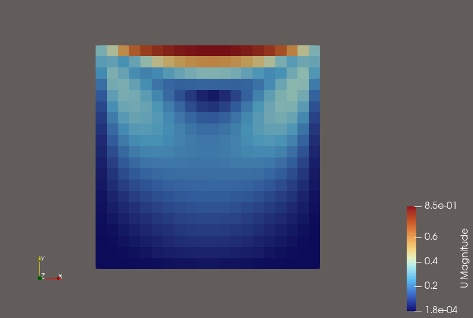
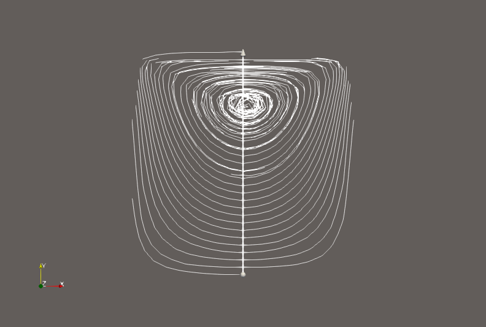

# Lid-driven cavity (OpenFOAM v2606, icoFoam)

Laminar flow in a 0.1 m square cavity whose lid moves at 1 m/s (Re = 10), on a 20 × 20 mesh. The flow reaches steady state well before t = 0.5 s; the maximum Courant number stays at 0.85.

## Run

    blockMesh
    checkMesh
    icoFoam
    touch cavity.foam   # open in ParaView

## Results at t = 0.5 s

Velocity magnitude:

Streamlines (one primary vortex):

